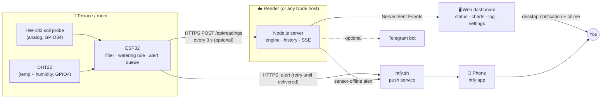
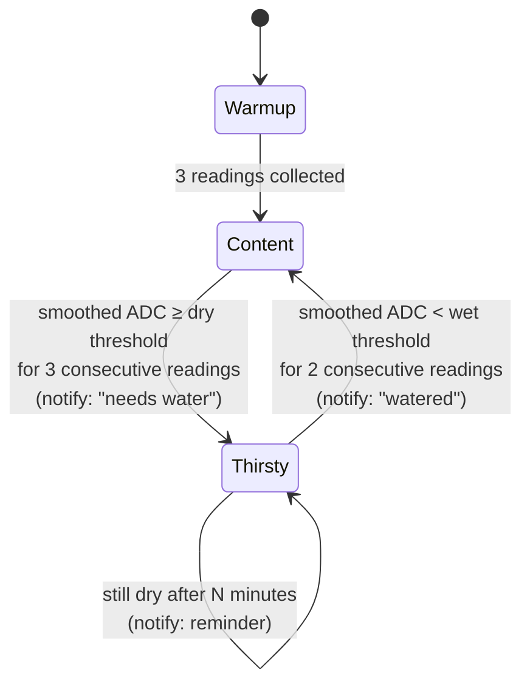

<div align="center">

# 🪴 FloraSense

**A low-cost IoT plant monitor that tells you the moment your plant needs water.**

ESP32 · HW-103 soil probe · DHT22 · ntfy push notifications · live web dashboard


</div>

---

## Table of contents

1. [The problem](#1-the-problem)
2. [What FloraSense does](#2-what-florasense-does)
3. [What makes it different: notifications](#3-what-makes-it-different-notifications)
4. [Architecture](#4-architecture)
5. [How it works](#5-how-it-works)
6. [Hardware](#6-hardware)
7. [Repository layout](#7-repository-layout)
8. [Getting started](#8-getting-started)
9. [Deploying to the cloud (Render)](#9-deploying-to-the-cloud-render)
10. [Configuration reference](#10-configuration-reference)
11. [Calibration & accuracy](#11-calibration--accuracy)
12. [Impact](#12-impact)
13. [Limitations](#13-limitations)
14. [Roadmap](#14-roadmap)

---

## 1. The problem

Houseplants and terrace gardens usually die from one of two things: **forgetting to water**, or **watering by guesswork**. Commercial smart-garden systems solve this but are expensive, locked to a vendor app, or need constant attention. Checking a dashboard doesn't help either: a plant that is thirsty at 3 pm needs to *tell you*, not wait for you to look.

## 2. What FloraSense does

FloraSense continuously measures the soil and the air around a plant, shows everything on a live dashboard, and **pushes a notification to your phone when the plant needs water**.

| Capability | Detail |
|---|---|
| Soil dryness | HW-103 resistive probe on an ESP32 analog pin, averaged and filtered |
| Air temperature & humidity | DHT22 sensor |
| Live dashboard | Plant status in plain words, wet-to-dry scale, trend charts, event log |
| Smart alerts | Needs water, watered, repeat reminders, too hot / cold / humid, sensor offline |
| Works for any plant | Plant name and thresholds are configurable (a cactus and a fern need different values) |
| Runs standalone | The ESP32 sends watering alerts by itself, no laptop required |

## 3. What makes it different: notifications

Most hobby plant monitors stop at a dashboard. FloraSense treats **the notification as the product**:

- **Decided on the device.** The ESP32 runs the watering rule itself and calls the notification service directly. Even if your laptop is off or the cloud dashboard is down, the alert still reaches your phone.
- **Never lost.** If Wi-Fi drops when an alert fires, the ESP32 keeps the alert and retries until it is delivered.
- **No flapping.** Alerts need several confirming readings, and "watered" uses a separate lower threshold (hysteresis), so noisy readings don't spam you.
- **Reminders.** A still-thirsty plant re-notifies every N minutes (default 60).
- **Multiple channels.** Phone push via [ntfy](https://ntfy.sh) (free, no account), optional Telegram, plus desktop notifications and a chime in the dashboard.
- **Watches the watcher.** If the sensor itself goes silent, the server raises a "sensor offline" alert.

## 4. Architecture



**Two independent paths.** The *alert path* (ESP32 → ntfy → phone) has no server in it. The *dashboard path* (ESP32 → server → browser) is for visibility and history. Either can fail without breaking the other.

### Alternative: USB mode

While developing, the same server can read the ESP32 directly over USB serial (no Wi-Fi), parsing the original test-sketch output:

```
ESP32 --USB serial--> Node server (COM port) --> dashboard + notifications
```

## 5. How it works

### Signal processing

1. The ESP32 averages 10 ADC samples (about 200 ms) per reading.
2. A **median of the last 5** readings rejects single-sample spikes.
3. An **exponential moving average** smooths remaining jitter.
4. Large real changes (more than 600 ADC counts, e.g. probe pulled out or plant watered) **pass straight through**, so the response stays fast.

The raw value is always kept and shown for diagnostics.

### Watering state machine



On this hardware **lower ADC = wetter soil**. Defaults are 1800 (needs water) and 1500 (recovered); the gap between them is the hysteresis band.

### Dashboard

The Node server keeps recent history, runs the same rules, and streams every reading to the browser over Server-Sent Events, so the status card, scale, numbers and chart all update from one message and stay in sync.

## 6. Hardware

| Component | Role |
|---|---|
| ESP32 Dev Module (ESP32-D0WD-V3) | Sensing, filtering, alert logic, Wi-Fi |
| HW-103 module + HW-080 two-prong probe | Resistive soil-moisture sensing |
| DHT22 / AM2302 breakout | Air temperature and relative humidity |
| Breadboard, Micro-USB data cable | Prototyping and power (phone charger or power bank) |

### Wiring

| Part | Pin | ESP32 |
|---|---|---|
| HW-103 | VCC | 3V3 |
| HW-103 | GND | GND |
| HW-103 | AO | GPIO34 (input-only ADC pin) |
| HW-103 | DO | not connected |
| DHT22 | + | 3V3 |
| DHT22 | OUT | GPIO4 |
| DHT22 | - | GND |

> The HW-103 is powered from 3.3 V so its analog output never exceeds the ESP32's input range.

## 7. Repository layout

```
florasense/
├── firmware/FloraSense/
│   ├── FloraSense.ino          # ESP32 firmware (single setup/loop)
│   ├── secrets.h.example       # Wi-Fi, ntfy topic, thresholds, server (copy to secrets.h)
│   └── secrets.h               # local only, git-ignored
├── server/
│   ├── server.js               # HTTP API, SSE stream, auth, persistence
│   ├── engine.js               # filtering, calibration, alert state machine
│   ├── notifiers.js            # ntfy and Telegram delivery
│   └── sources.js              # USB serial reader and demo simulator
├── public/                     # dashboard (HTML, CSS, vanilla JS, no build step)
├── render.yaml                 # one-click Render blueprint
├── config.example.json         # local server config
└── package.json
```

## 8. Getting started

### Prerequisites

- Node.js 18+ (developed on 20)
- Arduino IDE with the ESP32 board package and the Adafruit **DHT sensor library**
- A phone with the free **ntfy** app

### A. Try the dashboard with no hardware

```bash
npm install
npm run demo
```

Open <http://localhost:3000>. A simulated plant dries out and gets watered so you can see every alert.

### B. Run with the ESP32 over USB

```bash
npm install
npm start
```

Edit `config.json` (copy from `config.example.json`) if your board isn't on `COM6`. Close the Arduino Serial Monitor first, since it locks the port.

### C. Standalone ESP32 with phone alerts

1. Copy `firmware/FloraSense/secrets.h.example` to `secrets.h` and set:
   - `WIFI_SSID` / `WIFI_PASSWORD`
   - `NTFY_TOPIC`: choose something hard to guess, e.g. `florasense-yourname-4821`
   - `PLANT_NAME` and the watering thresholds
2. Upload `FloraSense.ino` with the Arduino IDE.
3. In the ntfy app, subscribe to the same topic.
4. Pull the probe out of the soil. Your phone should buzz within a few seconds.

### D. Add the dashboard to the standalone setup

Set `SERVER_HOST`, `SERVER_PORT`, `SERVER_USE_TLS` and `API_KEY` in `secrets.h` (see below), then re-upload.

## 9. Deploying to the cloud (Render)

1. Push this repo to GitHub (a **private** repo is recommended). `.gitignore` keeps `secrets.h`, `config.json` and `data/` out of Git.
2. On Render, create a **Blueprint** from the repo. It reads `render.yaml`.
3. Set the environment variables when prompted:

| Variable | Purpose |
|---|---|
| `DASH_PASSWORD` | Password for the dashboard (any username is accepted) |
| `API_KEY` | Secret the ESP32 sends with each reading; auto-generated by Render |
| `FLORA_SETTINGS` | Your settings as JSON, e.g. `{"plantName":"Money plant","notify":{"ntfyTopic":"your-topic"}}` |
| `SERVER_PUSH` | `offline` (default in `render.yaml`): the server only alerts if the sensor goes silent |
| `SERIAL_PORT` | Left empty on the cloud |

4. In `secrets.h` set `SERVER_HOST` to the host only (e.g. `florasense-xxxx.onrender.com`, **no** `https://`), `SERVER_PORT 443`, `SERVER_USE_TLS 1`, and `API_KEY` to the same value as on Render.
5. Re-upload the firmware. The Serial Monitor should show `dashboard POST -> 200`.

> Render's free tier sleeps after 15 minutes without traffic and has a temporary disk, so history resets on restart. The ESP32's regular uploads keep it awake, and `FLORA_SETTINGS` re-applies your settings on each start.

## 10. Configuration reference

**Watering rule** (firmware `secrets.h` *and* dashboard Settings; keep them equal)

| Setting | Default | Meaning |
|---|---|---|
| `WATER_ABOVE_ADC` | 1800 | Smoothed ADC at/above this means "needs water" |
| `RECOVERED_BELOW_ADC` | 1500 | Must fall below this to count as watered |
| `CONFIRM_DRY_SAMPLES` | 3 | Consecutive dry readings before alerting |
| `CONFIRM_WET_SAMPLES` | 2 | Consecutive wet readings before clearing |
| `REMINDER_MINUTES` | 60 | Re-notify interval while thirsty (0 = off) |

**Server** (`config.json` or environment variables): `port`, `serialPort`, `baudRate`, `apiKey`, `serverPush` (`all` / `offline` / `none`), `dashPassword`.

**API**

| Endpoint | Description |
|---|---|
| `POST /api/readings` | ESP32 upload `{soilRaw, temperature, humidity}`; requires `x-api-key` if set |
| `GET /api/state` | Current status, settings, recent events |
| `GET /api/history?minutes=60` | Reading history |
| `GET /api/stream` | Server-Sent Events: live readings and alerts |
| `POST /api/settings` | Update settings |
| `POST /api/test-notification` | Send a test alert |

## 11. Calibration & accuracy

FloraSense is honest about what a **resistive** soil sensor can do:

- The dashboard always shows the **raw ADC value**. A **moisture percentage is hidden** until you mark both a dry and a wet point on a settled probe in the same pot.
- The default thresholds (1800 / 1500) are **starting points** from exploratory tests (dry pot soil read about 2200, moist soil about 800 to 1500). Tune them to your plant, pot and soil; a cactus and a fern want different values.
- Readings depend on soil type, salinity, temperature, probe depth and contact. The probe's reading drifts for a minute or two after insertion, and re-inserting it changes the baseline.
- A probe in air saturates at 4095; that is **not** a valid dry-soil reference.

Treat the output as a reliable "dry vs. moist" signal for a prototype, not a laboratory measurement.

## 12. Impact

- **Healthier plants, less guesswork.** Watering on real soil data instead of schedule or habit reduces both under- and over-watering.
- **Saves water.** Watering only when needed avoids routine over-watering, which matters for terraces and water-scarce areas.
- **Helps people who can't check often.** Travelers, busy households, and anyone with a hard-to-reach terrace garden get a timely nudge instead of a dead plant.
- **Accessible.** The whole build uses inexpensive, common parts, free services (ntfy, Render free tier) and open tooling, so schools, makers and students can reproduce it.
- **Teaches real IoT engineering.** Sensor filtering, hysteresis, store-and-retry delivery, edge-vs-cloud design and secure deployment, all in a small readable codebase.

## 13. Limitations

- **One soil probe**, so one soil zone. Multiple zones need additional sensors and wiring.
- **Resistive probes corrode** in wet soil over time and are not weatherproof. The ESP32 and module need a sealed enclosure outdoors.
- DHT22 readings have not been checked against a calibrated reference instrument.
- The firmware skips TLS certificate verification (`setInsecure()`) for simplicity. Pin a CA certificate before any production use.
- The ntfy topic acts like a shared secret on the public ntfy.sh server; use a long random topic or self-host ntfy.
- Environment alert thresholds (35 °C / 12 °C / 85% RH) are placeholders, not plant-specific care guidance.
- The Render free tier sleeps when idle and does not keep history across restarts.

## 14. Roadmap

- [ ] Guided two-point calibration with a documented procedure
- [ ] Per-plant profiles (cactus, fern, herb, etc.) with sensible default thresholds
- [ ] Capacitive soil sensor to remove probe corrosion
- [ ] Persistent history (database) on the cloud host
- [ ] Multi-zone support with additional probes
- [ ] Low-power deep-sleep mode for battery or solar operation
- [ ] Self-hosted ntfy and certificate pinning

---

<div align="center">

Built as a hands-on IoT project: sensors → edge logic → notifications you can actually act on. 🚿

</div>
